<p align="center">
  <picture>
    <source media="(prefers-color-scheme: dark)" srcset="docs/media/hero-dark.webp">
    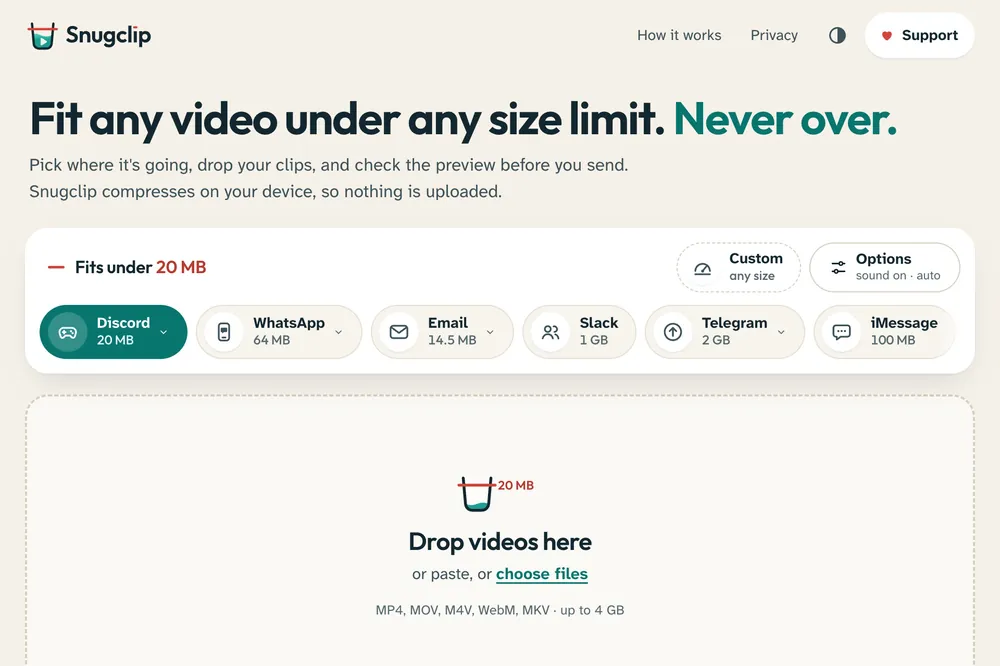
  </picture>
</p>

<p align="center">
  <a href="https://snugclip.vercel.app">
    <picture>
      <source media="(prefers-color-scheme: dark)" srcset="brand/logo-dark.svg">
      
    </picture>
  </a>
</p>

<h3 align="center">Fit any video under any size limit. Never over.</h3>

<p align="center">
  Snugclip compresses a video to fit an exact limit, like Discord's 20 MB, and never gives you a file over it.<br>
  Check the before/after preview, then send. Free, open source, and your video never leaves your device.
</p>

<p align="center">
  <a href="https://snugclip.vercel.app"></a>
</p>

<p align="center">
  <a href="LICENSE"></a>
  
  
  <a href="AGENTS.md"></a>
</p>

<p align="center">
  <a href="#before-and-after">Before and after</a> ·
  <a href="#features">Features</a> ·
  <a href="#privacy">Privacy</a> ·
  <a href="#run-it-locally">Run it</a> ·
  <a href="#for-agents-cli-and-mcp">CLI and MCP</a> ·
  <a href="#how-the-size-is-guaranteed">How it fits</a>
</p>

---

## Before and after

A 45.8 MB, 24-second 1080p clip, compressed in the browser for Discord's 20 MB limit. The result is 18.8 MB, still 1080p at 30 fps, with 1.18 MB to spare. Both crops are the same frame, pixel for pixel.

<picture>
  <source media="(prefers-color-scheme: dark)" srcset="docs/media/before-after-dark.webp">
  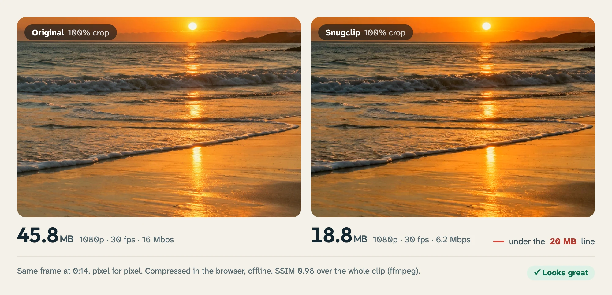
</picture>


## Why Snugclip

- **Never over the limit.** Pick where the clip is going and Snugclip aims just under that size. It never writes a file over it. If a clip can't fit even at the lowest quality, it tells you before it starts, and how short it would need to be.
- **See it before you send it.** A before/after slider with synced playback, and a quality score in plain words: *Looks great*, *Softer, still clear* or *Noticeably soft*.
- **Private.** Compression runs in your browser with its own video engine (WebCodecs). There is no upload, no account and no server.
- **Free.** No watermark, no file-size cap, no locked features. MIT licensed.

## Features

### Pick where it's going

One tap sets the limit. Every preset links its official source and the date it was checked (September 2026).

| Destination | Limit | Notes |
| --- | --- | --- |
| Discord | 20 MB | Free tier. Nitro Basic (50 MB) and Nitro (500 MB) are one tap away. |
| WhatsApp | 64 MB | Also caps at 720p, which WhatsApp would downsize to anyway. |
| Email | 14.5 MB (Outlook) / 18 MB (Gmail) | The message limit minus base64 encoding overhead. |
| Slack, Telegram, iMessage | 1 GB, 2 GB, 100 MB | |
| Plain sizes | 8, 10, 25, 50, 100 MB | Or type any size. 1 MB = 1,000,000 bytes. |

### The measuring glass

Each clip gets a glass with the limit drawn as a line. When a clip is done the glass fills to its real size and settles under the line, with the exact size, how much room is left and how much smaller it got.

<table>
  <tr>
    <td width="68%">
      <picture>
        <source media="(prefers-color-scheme: dark)" srcset="docs/screenshots/review-desktop-dark.webp">
        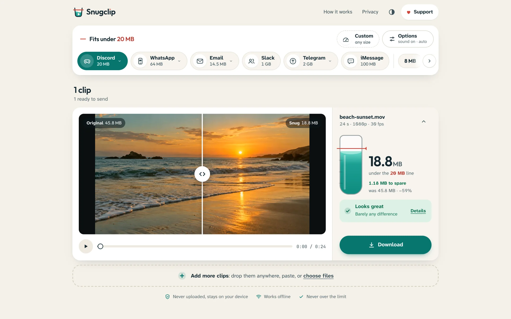
      </picture>
    </td>
    <td width="32%">
      <picture>
        <source media="(prefers-color-scheme: dark)" srcset="docs/screenshots/review-phone-dark.webp">
        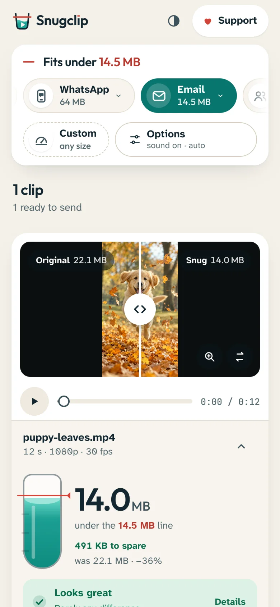
      </picture>
    </td>
  </tr>
</table>

### And the rest

- **Batch.** Drop a folder of clips. They compress one after another, each with its own fit, and *Download all* gives you one .zip.
- **Trim when it won't fit.** A filmstrip trimmer with a live hint that turns green the moment the selected range fits.
- **Options, with sensible defaults.** Compatible (H.264 MP4, plays everywhere) or Smaller (AV1/HEVC). Keep or drop sound, keep the frame rate or allow 60 to 30 fps, cap the resolution.
- **Already small enough?** Files under the limit are kept byte for byte, unless you ask to re-encode.
- **Works offline.** Snugclip is a PWA. After one visit it works with Wi-Fi off. Every clip in the launch video was compressed offline.
- **Plain-language errors.** An unsupported codec or a slow device gets a clear reason and a next step, never a silent failure.
- **Job files and deep links.** `?preset=discord&maxh=720` opens the tool with settings applied, and a `*.snugclip.json` job file carries a full setup, so an agent can hand a person a ready result.

Snugclip runs in Chrome, Edge and Brave (desktop and Android), Safari 26+ on Mac and iPhone, and Firefox on desktop.

## Privacy

Snugclip is a static site. Your videos are decoded, compressed and checked on your own device, in your browser, and are never uploaded anywhere. There are no accounts, no analytics, no ads and no third-party scripts or fonts. After the page loads, Snugclip makes no network requests at all; you can confirm it in your browser's Network tab, or by turning off Wi-Fi. Compressed files live in temporary browser storage until you download or remove them, and are cleared on your next visit.

The CLI and MCP server run on your machine with the ffmpeg you install. They make no network calls either.

## Run it locally

You need Node 22.12 or newer and pnpm 11.

```bash
pnpm i && pnpm --filter @snugclip/web dev
```

Then open http://localhost:4317.

To self-host, build the static site and upload `apps/web/out/` to any static host. There are no environment variables, API routes or databases.

```bash
pnpm --filter @snugclip/web build    # writes apps/web/out/
pnpm --filter @snugclip/web serve    # optional: preview it with the zero-dependency static server
```

## For agents: CLI and MCP

The same engine runs as a CLI with `--json` output and stable exit codes, and as a local stdio MCP server with four tools (`compress_video`, `plan_compression`, `probe_video`, `list_presets`). Both use the ffmpeg and ffprobe on your machine. The full reference, with the JSON report shape and worked examples, is in [AGENTS.md](AGENTS.md).

```bash
pnpm install && pnpm build          # from the repo root
pnpm snugclip compress beach-sunset.mov --preset discord
```

```text
fit  beach-sunset.mov → beach-sunset-snug-20MB.mp4  19.4 MB of Discord (97.4%) · 1920x1080 30 fps H264 · Looks great (SSIM 0.998) · 1 attempt · 26.5 s
```

```bash
snugclip plan talk.mp4 --size 8MB --json          # dry run: will it fit, and at what resolution?
snugclip compress ./recordings --preset email --out-dir ./email-ready --json
```

Exit code `0` means every file fits, `2` means a target is impossible (the JSON says the smallest size that would fit), `3` is an unsupported input and `4` means ffmpeg is missing.

To use the MCP server, point your client at it:

```json
{
  "mcpServers": {
    "snugclip": { "command": "node", "args": ["/path/to/snugclip/packages/mcp/bin/snugclip-mcp.js"] }
  }
}
```

## How the size is guaranteed

1. **Plan first.** Snugclip reads the clip's length, resolution and motion, reserves room for audio and the container, and picks a resolution and bitrate. If even the smallest usable settings can't fit, it refuses before encoding and reports the minimum size.
2. **Aim under.** The first encode aims 2 to 4% under the limit.
3. **Correct, don't gamble.** If an encode lands over, it is discarded and the next attempt corrects the bitrate from what actually happened (and drops a resolution step if the encoder can't go lower). It stops after a few attempts rather than keep an oversized file.
4. **Only a fitting file is kept.** Output is written to a temporary file and handed to you only when its size is at or under the limit. The quality check then compares 10 matched frames with the original (SSIM and PSNR) and turns the score into words.

## Tested

- **CLI fit matrix:** 276 runs: 17 synthetic fixtures against every preset size plus targets from just below the minimum to half the file. 0 outputs over the target; the closest landed at 99.3% of it. Every too-small target was refused before encoding.
- **Browser fit matrix:** 279 runs in headless Chrome. 0 outputs over the target.
- **Speed:** a 60-second 1080p clip fit under 10 MB in 7.1 s in the browser (9.54 MB, SSIM 0.961).
- CLI golden tests, scripted MCP sessions, unit tests for the core, and Playwright end-to-end tests with axe accessibility checks. All test media is synthetic.

## Screenshots

<table>
  <tr>
    <td width="50%">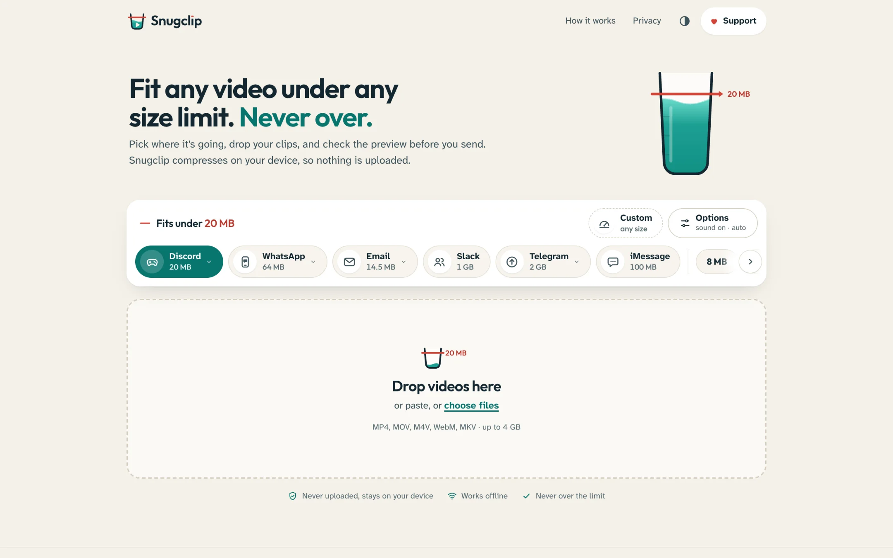</td>
    <td width="50%">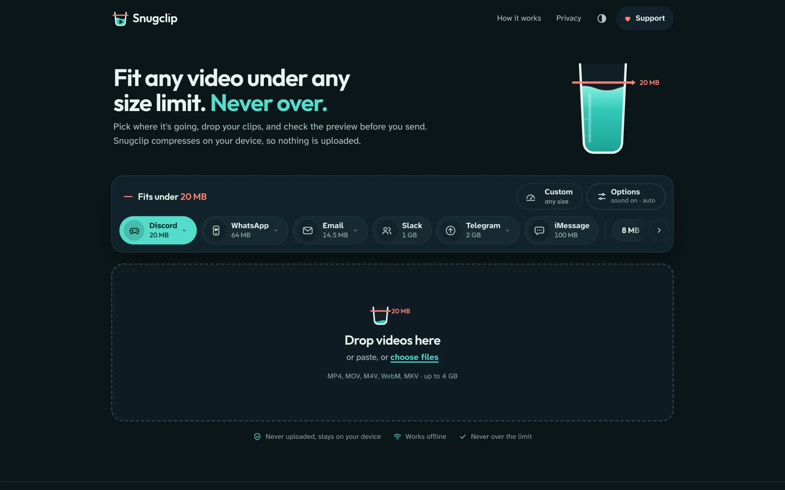</td>
  </tr>
  <tr>
    <td width="50%">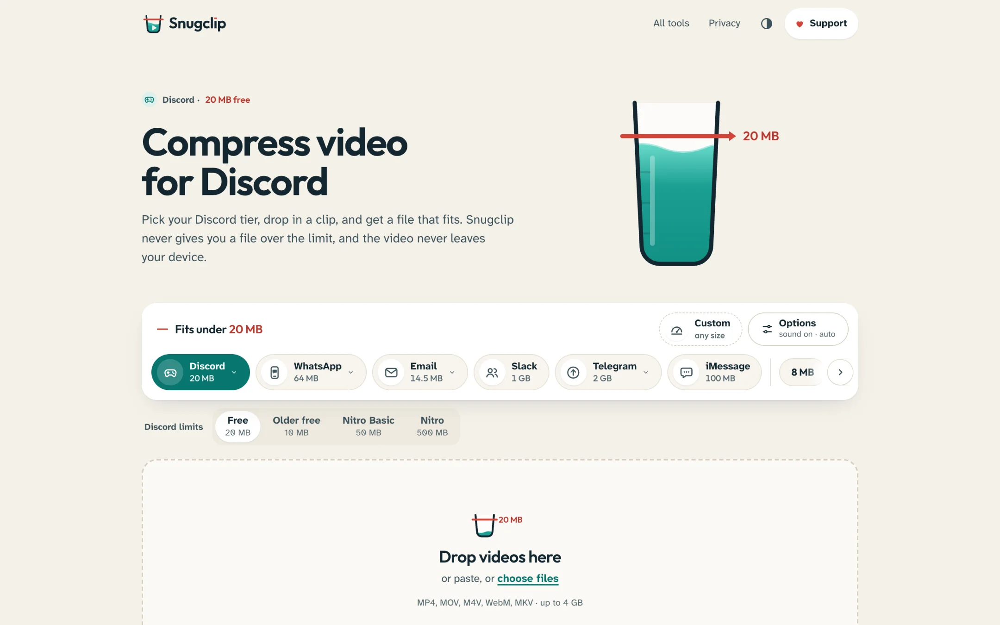</td>
    <td width="50%">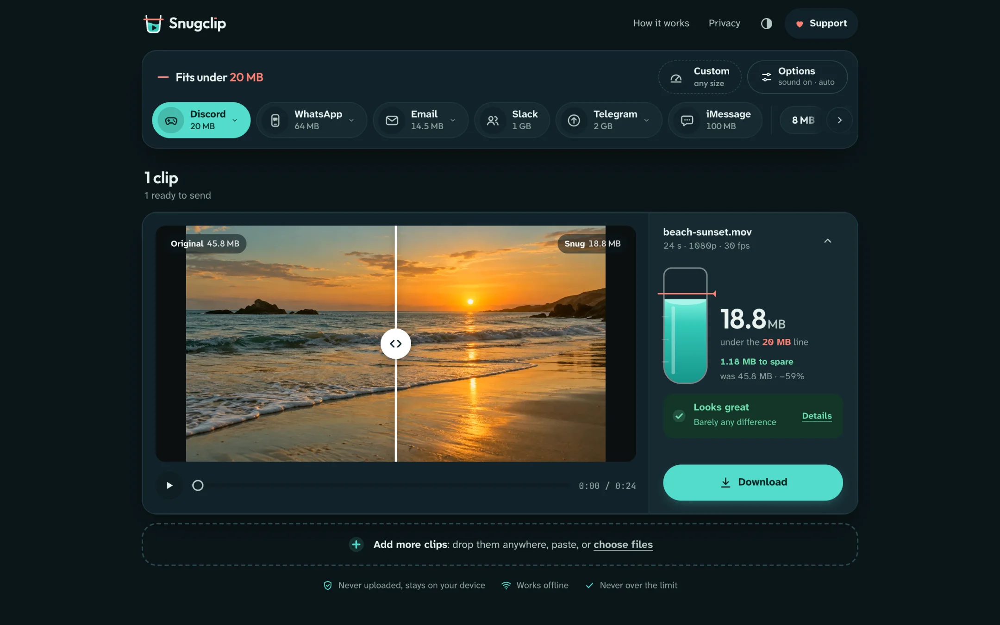</td>
  </tr>
</table>

<table>
  <tr>
    <td>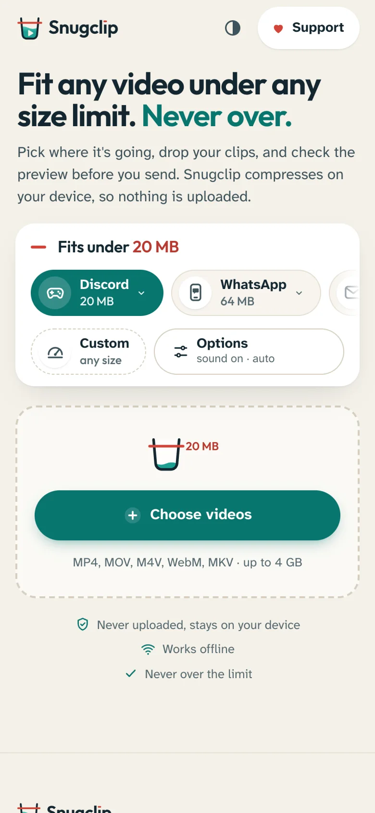</td>
    <td></td>
    <td>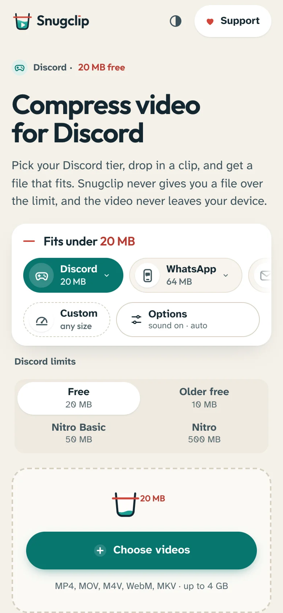</td>
    <td>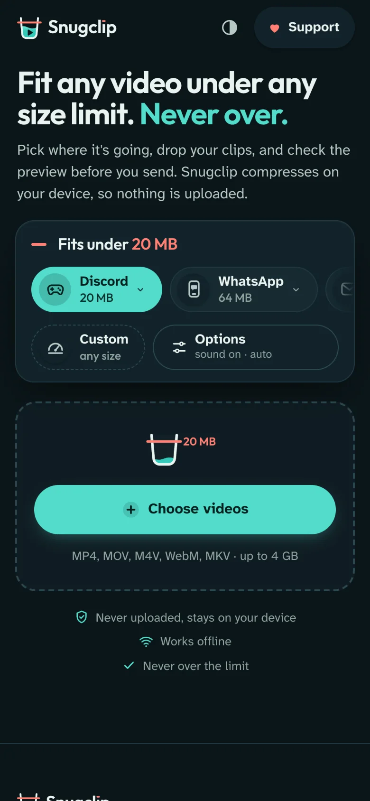</td>
    <td>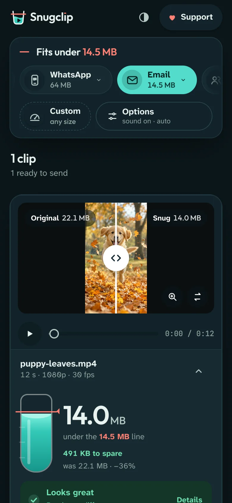</td>
    <td>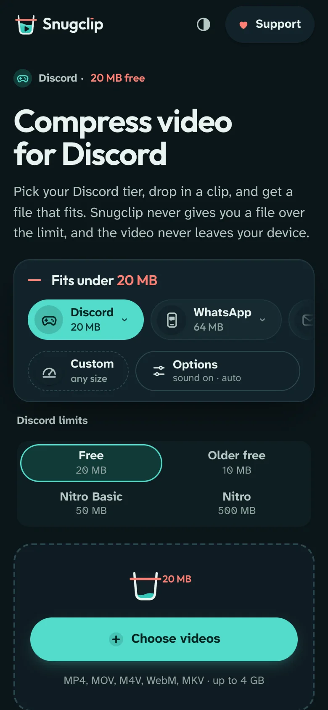</td>
  </tr>
</table>

## Project layout

| Path | What it is |
| --- | --- |
| [`packages/core`](packages/core) | The planner, fit loop, presets, quality verdicts and job-file schema. Pure TypeScript with no DOM or Node APIs. |
| [`packages/engine-web`](packages/engine-web) | The browser engine (WebCodecs through Mediabunny). |
| [`packages/engine-ffmpeg`](packages/engine-ffmpeg) | The engine for the CLI and MCP server, using your ffmpeg. |
| [`packages/cli`](packages/cli), [`packages/mcp`](packages/mcp) | `snugclip` and `snugclip-mcp`. |
| [`apps/web`](apps/web) | The Next.js static site, offline service worker and keyword pages. |

## Credits

Snugclip is built on [Mediabunny](https://mediabunny.dev) (MPL-2.0), [ssim.js](https://github.com/obartra/ssim), [Zod](https://zod.dev), [Serwist](https://serwist.pages.dev), [client-zip](https://github.com/Touffy/client-zip), [Next.js](https://nextjs.org), [React](https://react.dev), [Tailwind CSS](https://tailwindcss.com) and the [MCP TypeScript SDK](https://github.com/modelcontextprotocol/typescript-sdk). Browsers without their own AAC encoder load FFmpeg's AAC encoder as a separate WebAssembly file (LGPL-2.1). Type is set in [Outfit](https://github.com/Outfitio/Outfit-Fonts), [Atkinson Hyperlegible Next](https://www.brailleinstitute.org/freefont/) and [JetBrains Mono](https://github.com/JetBrains/JetBrainsMono) (SIL OFL 1.1). The logo, glyphs, demo clips and launch media are original and MIT licensed. Platform names appear in text only; no platform logos are used. Full notices are in [CREDITS.md](CREDITS.md).

## Support

Snugclip is free, with no watermark and no locked features. If it saved you a round of export-and-retry, you can [support the project](https://snugclip.vercel.app/support/) with a one-off tip or a small monthly contribution.

## License

[MIT](LICENSE) © 2026 Bilal Tahir
